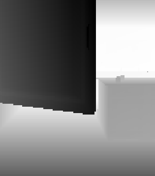

# MimiCry Experiments

# Game

Two scientists at a secret research facility are studying demons in an attempt to harness their power. However, the experiment begins to spiral out of control.
Unable to see one of the primary colors (one is red-blind, the other green-blind), they must work together to solve the research procedures and bring the situation under control.


## Requirements

- GPU supporting OpenGL 4.6
- GPU supporting `GL_ARB_bindless_texture` ([Check compatibility](https://www.realtech-vr.com/glview/))
- [Visual C++ Redistributable (x64)](https://learn.microsoft.com/en-us/cpp/windows/latest-supported-vc-redist)

## How to Run

1. Download the latest release from the [Releases](../../releases) page.
2. Extract the downloaded archive.
3. Run the executable.

## Executables

- `MimiCry_Experiments.exe` - Main game.
- `MimiCry_Experiments_ImGui.exe` - Engine editor.

# 3D Game Engine

## About

A 3D game engine built with **OpenGL 4.6**, developed by Zespół pięśni i hazardu.

## How to Build

Run the following command to generate the build:

```
cmake -B build
```

The generated `.sln` file will be located in the `/build` directory. Open it in Visual Studio, right-click the `MimiCry_Experiments` project in Solution Explorer, and select **Set as Startup Project**. Then build and run the application.

To compile C++ compiler with C++20 support is required. 


## Editor


## System

### Core

The engine uses a **hybrid GameObject-Component / ECS architecture**. It combines the
ergonomics of a Unity-style object model with system-driven processing over cached queries.

### Rendering

The renderer is **GPU-driven**: the GPU decides what is visible and draws it with a single indirect call, keeping CPU overhead low.

- GPU-driven pipeline
	- Uses **`glMultiDrawElementsIndirect`** to render multiple meshes in a single call using draw commands stored in a GPU buffer.
	- A **compute shader** performs GPU-side culling and generates draw commands for visible objects.

- GPU culling
	- **Frustum culling**: discards objects outside the camera's field of view.
	- **Hierarchical Z-culling (Hi-Z)**: discards objects occluded by other geometry.
	
	A depth mip chain is built from the camera's depth buffer, and the bounds of each object are tested against it in the compute shader.

- Materials and textures
	- **Bindless textures**: shaders access textures directly through handles.
	- **PBR (physically based rendering)**

- Shadow mapping
- Post-processing
	- Custom post-processing shader to exclude a selected RGB color per camera.

### Animation

- Skeletal animation (bones, animation clips)
- Looping and adjustable playback speed

### Navigation System
- **NavMesh generation** with four interchangeable methods:
  - Delaunay triangulation (Bowyer-Watson)
  - Voxel grid with flood-fill region labeling (Recast-inspired)
  - Voronoi (dual Delaunay)
- Obstacle handling with agent radius and height
- Triangle adjacency graph and **A\*** pathfinding
- Path smoothing with the **funnel algorithm**
- Agent state machine: idle, path request, moving, arrived, external control

### Physics

The engine has its own physics system based on AABB collisions.

- **Triggers**
- **Static objects**
- **Bounciness**
- **Interpolation**: reduces artifacts typical of **DCD**.

### Resource Manager

Centrally manages loading of game assets.

- **Models and animations**: import of `.glb` models together with their animations.
- **Textures**: image loading and caching in the compressed DXT5 format.


### Other Systems
- **Audio**: sound system built on [FMOD](https://www.fmod.com/)
- **HID**: input device handling
- **UI**: user interface with buttons and sliders
- **Sprites**: 2D graphics with frame animation, texture scrolling, outlined text, and layers
- **Surface Decoration System**: system for decorating surfaces
